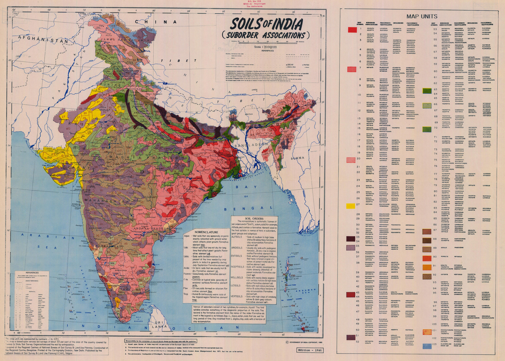
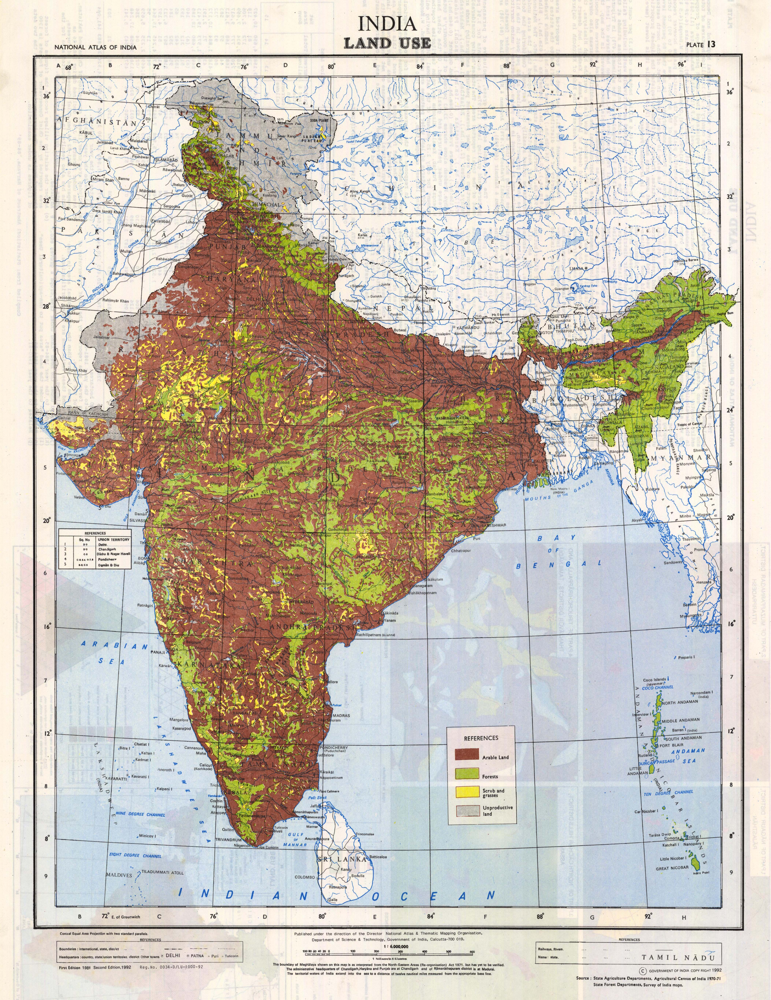

1. - [x] https://soilgrids.org/ (web platform)

2. - [x] https://esdac.jrc.ec.europa.eu/resource-type/maps
   -  - https://esdac.jrc.ec.europa.eu/images/Eudasm/Asia/images/maps/download/IN1000_SOTO.jpg
   -  - https://esdac.jrc.ec.europa.eu/images/Eudasm/Asia/images/maps/download/IN1003_SO.jpg
   -  - https://esdac.jrc.ec.europa.eu/images/Eudasm/Asia/images/maps/download/IN1007_TOLU.jpg
   - [[JRC_Asia_Atlas_EN_online_Final.pdf]] elevation map (page 37) https://esdac.jrc.ec.europa.eu/public_path//shared_folder/Atlases/JRC_Asia_Atlas_EN_online_Final.pdf
3. - [x] For more numeric data: https://isis.isric.org/monoliths/reference-soil-it013 (https://isis.isric.org/search/node/Soil%20type%20over%20India)

4. - [ ] https://esdac.jrc.ec.europa.eu/resource-type/national-soil-maps-eudasm?type=data_inventory_eudasm&field_data_continent_tid_selective=1267&field_data_country_country_selective=IN&field_data_cont_coverage_value=
